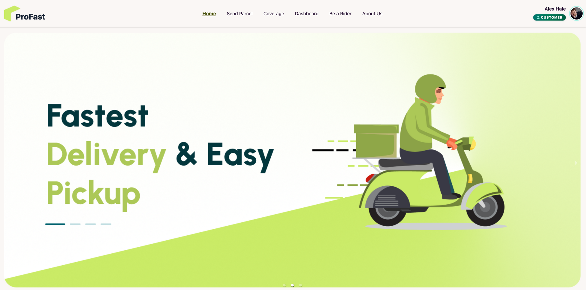

# Pro-Fast Delivery System Client

A high-performance, full-featured web application for courier and parcel logistics management, featuring dedicated role-based portals for users, delivery riders, and administrators. Built with React 19, TypeScript, Vite, Tailwind CSS, DaisyUI, and Firebase.



## Live URLs

- **Client Web Application:** [https://zap-shift-abec3.web.app/](https://zap-shift-abec3.web.app/)
- **Production API Server:** [https://pro-fast-delivery-system-server.vercel.app/](https://pro-fast-delivery-system-server.vercel.app/)
- **Backend GitHub Repository:** [Pro-Fast-Delivery-System-Server](https://github.com/ranak8811/Pro-Fast-Delivery-System-Server.git)

---

## Key Features

### 📦 Customer Portal
- **Express Parcel Dispatch (`/sendParcel`):** Dynamic shipping form with automatic same-district vs inter-district tariff computation, weight surcharge calculation, and doorstep pickup scheduling.
- **My Parcels Management (`/dashboard/myParcels`):** Reusable data table with server-side pagination, status pill badges, debounced search, delivery status filters, and one-click tracking ID copy.
- **AI-Powered Live Parcel Tracking (`/dashboard/trackParcel`):** Real-time shipment milestone timeline paired with an integrated **AI Smart Tracking Assistant** card for status predictions and milestone breakdowns.
- **Interactive Nationwide Coverage Map (`/coverage`):** High-performance Leaflet map covering all 64 districts in Bangladesh with an isolated floating search bar, instant auto-complete suggestions, and quick hub filters (Dhaka, Chattogram, Sylhet, etc.).
- **Payment Gateway & History:** Integrated Stripe checkout with full payment history, receipt tracking, and transaction verification.

### 🛵 Rider Operations Portal
- **Pending Deliveries (`/dashboard/pendingDeliveries`):** Live dispatch board for assigned parcels with one-click status transitions (Pickup, In-Transit, Delivered).
- **Completed Deliveries & Payouts (`/dashboard/completedDeliveries`):** Detailed delivery audit logs, total earnings calculator, and withdrawal cashout dialogs.
- **Earnings Overview (`/dashboard/myEarnings`):** Visual breakdown of daily, weekly, and total rider revenue.
- **Rider Application (`/beARider`):** Dedicated onboarding form with driving license and vehicle registration validation.

### 🛡️ Administrative Portal
- **Admin Dashboard (`/dashboard/admin`):** High-level KPI metrics, real-time dispatch status breakdown, and quick action controls.
- **Rider Fleet Management (`/dashboard/activeRiders` & `/dashboard/pendingRiders`):** Review rider applications, verify credentials, activate or suspend riders with server-side paginated tables.
- **Parcel Dispatch Board (`/dashboard/assignRider`):** Assign pending shipments to verified active riders based on service centers.
- **User Role Management (`/dashboard/makeAdmin`):** Search users with debounced queries and toggle role permissions between User, Rider, and Admin.

---

## UI/UX & Architecture Highlights

- **Brand Design System:** Clean, modern visual language inspired by `#20363A` (deep teal brand color) and `#CAEB66` (high-visibility lime green accent) with rounded cards, subtle borders, and accessible typography.
- **Generic `<DataTable<T>>` Component:** Accessible, reusable table supporting customizable column definitions, skeleton loading states, empty state illustrations, and responsive horizontal scrolling.
- **Generic `<Pagination>` Component:** Compact sliding-window page selector with dynamic page sizes (5, 10, 20, 50 items/page), ellipsis jumps, and record count indicators.
- **Defensive Data Loaders:** Resilient data fetching with absolute paths, content-type checks, and automatic fallback requests to ensure 100% uptime even on client-side routing edge cases.
- **Z-Index Isolation:** CSS `isolation: isolate` and `z-50` sticky navigation preventing map markers or search dialogs from clipping over the navbar.

---

## Technologies Used

<div align="center">

| Category | Technologies & Libraries |
|---|---|
| **Core & Language** |    |
| **Styling & UI** |    |
| **Routing & Query** |    |
| **Auth & Hosting** |  |
| **Payments** |  |
| **Maps & Geospatial** |   |
| **Visuals & Charts** |   |
| **Forms & UX** |    |

</div>

---

## Getting Started

### Prerequisites
- Node.js (v18.0 or higher recommended)
- npm or yarn

### Installation

1. **Clone the repository:**
   ```bash
   git clone https://github.com/ranak8811/Pro-Fast-Delivery-System-Client.git
   cd Pro-Fast-Delivery-System-Client
   ```

2. **Install dependencies:**
   ```bash
   npm install
   ```

3. **Configure Environment Variables:**
   Create a `.env.local` file in the project root with the following configuration:
   ```env
   VITE_apiKey=your_firebase_api_key
   VITE_authDomain=your_project.firebaseapp.com
   VITE_projectId=your_project_id
   VITE_storageBucket=your_project.appspot.com
   VITE_messagingSenderId=your_sender_id
   VITE_appId=your_app_id

   VITE_payment_key=your_stripe_publishable_key
   VITE_imgbb_key=your_imgbb_api_key
   VITE_API_URL=https://pro-fast-delivery-system-server.vercel.app
   ```

4. **Start Development Server:**
   ```bash
   npm run dev
   ```
   Open [http://localhost:5173](http://localhost:5173) in your browser.

5. **Build for Production:**
   ```bash
   npm run build
   ```

---

## Project Structure

```
Pro-Fast-Delivery-System-Client/
├── public/
│   ├── pro-fast-home.png          # Visual design reference asset
│   ├── serviceCenter.json         # 64 districts service center database
│   └── favicon.ico
├── src/
│   ├── assets/                    # Images, logos, and banners
│   ├── components/
│   │   ├── common/                # Reusable DataTable, Pagination components
│   │   ├── AITrackingAssistantCard.tsx
│   │   ├── Loading.tsx
│   │   └── ErrorPage.tsx
│   ├── contexts/                  # AuthContext and Providers
│   ├── hooks/                     # Custom hooks (useAxiosSecure, useAuth, useTitle)
│   ├── layouts/                   # RootLayout, DashboardLayout, AuthLayout
│   ├── pages/
│   │   ├── Home/                  # Landing page and promotional sections
│   │   ├── Dashboard/             # User, Rider, and Admin dashboard pages
│   │   ├── Coverage/              # Leaflet map and district search
│   │   └── SendParcel/            # Express parcel booking and cost estimator
│   ├── router/                    # React Router configuration
│   └── types/                     # TypeScript data interfaces
├── package.json
└── vite.config.ts
```

---

## License

This project is licensed under the MIT License.
